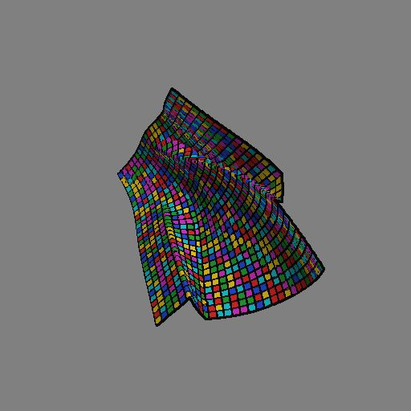
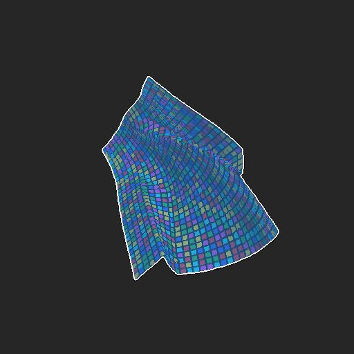
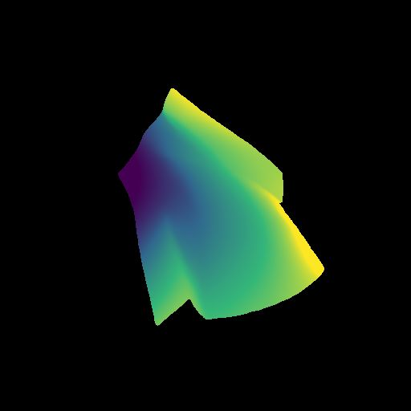
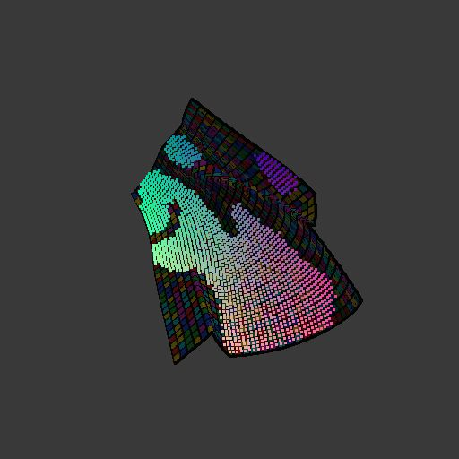
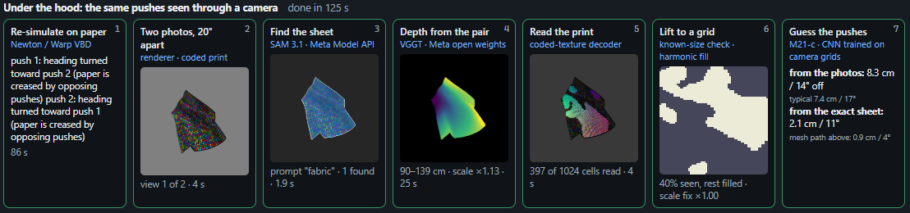

# Uncrumple

**Every crumple is a record of the forces that made it. Uncrumple reads it backwards:** from a
crumpled sheet to the pushes that crumpled it. Simulate a sheet, learn the inverse map from
deformed shape to applied forces, verify by re-simulation, then run the same question from
photographs with Meta's SAM 3.1, VGGT and Muse Spark.

| | |
|---|---|
| **Live demo** | https://uncrumple-demo.vercel.app (a GPU container stays warm 08:00-23:00 ET on the judging days, 2026-11-05 to 11-09; a push then takes about 10 s on the default model, or 1-2 min more off-hours while the server starts) |
| **Submission video** | https://www.youtube.com/watch?v=gC5Nzkt-WR4 ("Uncrumple Demo", 3 min, narrated); [`demo/demo.mp4`](demo/demo.mp4) is a 2 min 27 s silent capture of the live site kept as a backup |
| **Results** | [`cloth_results/RESULTS.md`](cloth_results/RESULTS.md) (every model, dated), [`cloth_results/photos/README.md`](cloth_results/photos/README.md) (the photo chain) |
| **Meta models** | In the pipeline: Meta Model API `sam-3.1`, `muse-spark-1.3`; open weights SAM 3 (`facebook/sam3`), VGGT (`facebook/VGGT-1B`), DINOv2 (ablation). In the build: Muse Spark for planning, Muse Code for the first demo scaffold. Details in [Use of Meta AI tooling](#use-of-meta-ai-tooling). |
| **Built** | 2026-10-27 to 2026-11-04 for the Meta AI Developer Hackathon. First commit 2026-10-27 22:49 ET; all code, data and results in this repository date from inside the building period. |

## Summary

A thin sheet (cloth or paper) remembers how it was loaded: creases, folds and stretch are the
integral of the forces that acted on it. This project asks the inverse question. Given only the
deformed geometry, **where** was the sheet pushed, in **which direction**, **how hard** and for
**how long**, and which pushes would undo the deformation?

The work runs in three stages, all in this repository:

1. **Virtual.** A GPU simulator (NVIDIA Newton / Warp, VBD solver with self-contact) crumples a
   0.5 m sheet with two Gaussian force patches. Thousands of such samples, generated as Slurm
   job arrays, train a convolutional inverse model that recovers both pushes from the final
   mesh. Predictions are checked by re-simulating them and comparing the resulting shape.
2. **Through a camera.** The same sheet is rendered as two photographs 20 degrees apart.
   SAM 3.1 finds the sheet, VGGT lifts it to a metric point cloud, a printed code gives
   per-vertex correspondences, hidden vertices are filled in, and a model trained on exactly
   these camera-derived grids recovers the pushes. Muse Spark writes the verdict.
3. **Live demo.** A judge pushes the sheet in the browser, watches it crumple, and sees the
   model's guess, the reversal, and every camera-path step with the Meta model that ran it.

At a glance (test-set means; position error in cm, direction error in degrees):

| setting | model | position | direction | source |
|---|---|---|---|---|
| Exact mesh with velocities (cloth, captured at release) | M16-a | **1.0 cm** | **4.3°** | `RESULTS.md` "M15 / M16-a" |
| Exact mesh, positions only (paper settled to rest) | M20-a3 | 2.8 cm | 6.6° | `RESULTS.md` "M21" |
| Camera chain: two rendered photos, SAM 3.1, VGGT, decoded print | M21-c | 7.4 cm | 17.0° | `RESULTS.md` "M21" |
| Same M21-c model on the exact grid | M21-c | 3.4 cm | 7.3° | `RESULTS.md` "M21" |
| Chance (random pushes) | | 14 cm | 94° | `RESULTS.md` "M16" |

Re-simulating M16-a's predicted pushes reproduces the sheet to 0.018 m centred RMSE (chance 0.126,
identical inputs replay bit-exactly below 1e-4). SAM 3.1 finds the sheet in 64 of 64 rendered
views at median IoU 0.990; the VGGT stereo lift reaches 1.42 cm median depth error with no
ground-truth scale.

## Impact

Everything around us, from car doors to clothing to the skin on a hand, is shaped by how
materials bend, stretch and break. Three-dimensional mechanics has decades of simulation and
inverse-analysis tooling behind it. Thin sheets are a different problem. A sheet bends far more
easily than it stretches (bending stiffness scales with thickness cubed, stretching stiffness
with thickness), so instead of deforming smoothly it crumples: strain collapses into sharp ridges
and cone-like points [[1](#references), [2](#references)].

That one behaviour governs crushed car panels, folding solar arrays, airbags, stent grafts,
packaging, paper and fabric. And a crumple is a record. Crash reconstruction already reads impact
energy off crush depth [[3](#references)]; origami engineering designs sheets that fold on
purpose, from Miura-ori solar arrays [[4](#references)] to stent grafts [[5](#references)]. If a model can read the record, it can say where a
crash hit, why a package failed, how a garment was grasped, or which push would undo the fold.

This project starts with the simplest version of that question: one sheet, one crumple, two
pushes. Given only the deformed shape, which forces made it, and which would undo it? Solving the
fundamental case is what makes the harder ones reachable:

- **Robots handling garments** can infer the grasp or push that crumpled an item and plan the
  motion that reverses it, instead of treating every crumpled state as new.
- **Sheet-goods lines** (paper, film, textiles) can plan pushes, or detect and reverse unwanted
  deformation, from a camera view of the sheet.
- **Forensics and design** share the inverse question: the loading history of a panel, a
  package or a fold-on-purpose structure, read from its final geometry.
- **The method is material-agnostic.** The pattern here (simulate, quality-gate, build a
  dataset, train the inverse model, verify by re-simulation) carries to any system whose loads
  must be read from its deformed shape; the third stage on the [roadmap](ROADMAP.md) is FEM
  meshes with contact-impulse labels, metal and tissue included.

**What is proven here, and what is not.** The inverse model recovers the pushes on simulated
cloth and paper to about one centimetre from the exact mesh, and to about seven centimetres
through a photograph-based pipeline on rendered photos with a printed code. No real phone photo
has been through the chain yet; the renders have a known camera motion, no clutter and no sensor
noise. Force magnitude is learned as a regularity of this solver rather than a conserved quantity
(see [Technical depth](#technical-depth--execution)). Those are the next steps, not hidden
assumptions.

## Use of Meta AI tooling

Meta models appear in this project in two ways: as **components of the pipeline** (SAM 3.1,
VGGT and Muse Spark run inside the deployed demo; SAM 3, VGGT and DINOv2 in the research
chain), and as **collaborators in the build**, from the first day's planning to the demo
scaffold.

### Muse Spark and Muse Code in the build

Before and during the eight-day build, the team used Muse Spark as the planning assistant and
Muse Code as the coding model for the parts of the project that had to be designed before they
could be measured:

- **Physics model choices.** How to load a simulated sheet so that its final shape carries the
  force information: two Gaussian patches in material coordinates, a constant force for a fixed
  duration, paper as plastic hinges with permanent creases, and the two capture modes (at
  release, and settled to rest for the single-photo setting). The resulting settings are the
  ones documented in [`transfer/REPORT.md`](cloth_data_generation/transfer/REPORT.md).
- **Network layouts.** The layout of the inverse models in
  [`models.py`](cloth_data_generation/inverse/models.py): the grid CNN with auxiliary heads, the
  hybrid strain/curvature input, the unordered-pair loss under the sheet's D4 symmetry, and the
  point-transformer variant for unordered clouds.
- **Initial demo scaffold.** The first version of the demo (FastAPI job endpoints with polling,
  the three.js sheet with free camera, the force cards and the arrow overlay) was scaffolded
  with Muse Code and then measured and reworked by hand.

These sessions are not tracked in the repository; what is tracked is their output, and every
number below was measured afterwards. The pipeline uses are the ones a judge can see run:

| model | access | where in the code | role in the pipeline | measured | in the live demo |
|---|---|---|---|---|---|
| **SAM 3.1** | Meta Model API (`POST api.meta.ai/v1/responses`) | [`cloth_data_generation/inverse/sam_api.py`](cloth_data_generation/inverse/sam_api.py) (own Python port of the one-bit mask decoder; the PyPI parser is an empty placeholder), demo step 2 in [`demo/backend/camera.py`](demo/backend/camera.py) | finds the sheet in each photo from a text prompt | 64/64 rendered views found, IoU median 0.990 (min 0.966), 0.97 s median per view; 352/400 views on the M21 test set, and where it finds the sheet the downstream error equals the renderer's own mask to 0.1 cm | yes, tile 3 |
| **SAM 3** open weights (`facebook/sam3`) | local | [`cloth_data_generation/inverse/segment.py`](cloth_data_generation/inverse/segment.py) | prompt study and offline fallback | "fabric" finds 47/48 cloth and 8/8 paper views at median IoU 0.985, equal to the oracle-box ceiling; "paper", "sheet", "textile" find nothing; as the chain's mask source it scores 7.6 cm / 17.5° vs 7.4 / 17.0 hosted | research only (the demo falls back to the renderer mask when the API misses) |
| **VGGT** (`facebook/VGGT-1B`) | open weights | [`lift.py`](cloth_data_generation/inverse/lift.py) (single view), [`lift_stereo.py`](cloth_data_generation/inverse/lift_stereo.py) (20° pair + known camera motion); demo step 3 | depth and intrinsics, then a metric point cloud | single view 4.0 cm RMSE after the best similarity fit; stereo pair with photometric scale and no ground truth: **1.42 cm median depth error**, point RMSE 3.19 cm, scale error 0.6 % median | yes, tile 4 |
| **Muse Spark** (`muse-spark-1.3`) | Meta Model API | [`demo/backend/narrate.py`](demo/backend/narrate.py) with [`t3_narrate.py`](cloth_data_generation/inverse/t3_narrate.py); agent in [`t2_reprompt.py`](cloth_data_generation/inverse/t2_reprompt.py) | writes the three-sentence verdict from the rounded numbers; as an agent, re-prompts SAM when it misses | narration: 15/15 verdicts pass the number check (every figure must come from the input), 22 s median; agent: recovers 60/64 views from the failing prompt "paper" and 62/64 from "sheet", 16/16 correct accepts, but a fixed prompt list gets 64/64 in 1.7 s | narration yes, tile 8; agent research only |
| **DINOv2** (ViT-S/14) | open weights | `models.py` `dino_reg` | pretrained encoder for the inverse model | loses: frozen 8.8 cm vs 6.4 cm for the CNN trained from scratch; unfrozen 9.5 cm | no (negative ablation) |
| MapAnything, SAM 3D Objects, DINOv3 | open weights | `lift_mapanything.py`; not run; code path only | metric lift alternatives | MapAnything 19-24 % scale error even with true intrinsics, dropped; SAM 3D Objects needs 32 GB VRAM, deferred; DINOv3 weights gated | no |

What the photo chain sees, left to right: the rendered photo with the coded print, the SAM 3.1
mask, VGGT's depth, and the decoded print correspondences.

| photo | SAM 3.1 mask | VGGT depth | decoded print |
|---|---|---|---|
|  |  |  |  |

Findings worth passing on about the tools (all from
[`cloth_results/photos/README.md`](cloth_results/photos/README.md)):

- SAM 3 and SAM 3.1 detection depends on the phrase, not the threshold: "fabric" is near
  perfect, "paper" fails on the same images, and every failure is a zero detection rather
  than a bad mask. A short fixed prompt list beats an LLM re-prompting agent on renders.
- Hosted SAM 3.1 and open-weight SAM 3 are interchangeable for this task end to end (0.2 cm
  apart), so the demo can use the API and keep the open weights as the offline path.
- VGGT's shape is good from one view (4 % median depth error) but its scale is not; a second
  photo with a known camera motion fixes scale to 0.6 % and halves the shape error.
- Muse Spark narration is reliable only with a hard check that every number it writes came
  from its input; with that check it passed 15/15.

## Technical depth & execution

**Simulator** ([`cloth_data_generation/transfer/`](cloth_data_generation/transfer/README.md),
physics notes in [`REPORT.md`](cloth_data_generation/transfer/REPORT.md)). Newton 1.7 / Warp
VBD, 0.5 m sheet on a 256x256 grid, self-contact with friction, zero gravity. Two Gaussian
force patches in material coordinates, each a constant force for 0.3-0.7 s. Labels per push:
`(u, v, direction, magnitude, duration)`, predicted as an unordered pair. Paper is modelled as
plastic hinges (yield 50 /m, creases permanent). Two capture modes: at the instant the force ends
(cloth), and settled to rest under air drag (paper, the single-photo setting). A quality gate
(stretch, NaN, piercing) rejects and retries bad samples.

**Data at scale** ([`cluster/`](cloth_data_generation/transfer/cluster/README.md),
[`DATASETS.md`](cloth_results/DATASETS.md)). Slurm job arrays with global slots and seeds, so a
dataset is independent of how the array is cut and re-submitting resumes. Datasets used by the
results above: `ds256_const` (about 2,300 training samples, cloth at release), `ds256_const_paper`
(1,356 / 169 / 169), `ds256_paper_rest` (1,808 passing samples of 4,000 slots, about 220 s each),
and the camera-chain split (2,892 / 362 / 362 photo-derived grids, each rendered, segmented,
lifted and decoded on the cluster). `ds256_free` alone took 106 GPU-hours.

**Models** ([`cloth_data_generation/inverse/`](cloth_data_generation/inverse/)). A ridge baseline,
grid CNNs (`cnn_reg`, `cnn_field`) with auxiliary heads and a D4-symmetric unordered-pair loss, a
hybrid input that adds intrinsic strain and curvature channels to positions (the change that
took the error from 1.7 cm to 1.0 cm), a point transformer for unordered clouds, and
DINOv2 / Sonata encoders as ablations. Privileges are removed one rung at a time (the
observation ladder in [`ROADMAP.md`](ROADMAP.md)) so the cost of each is measured: velocities,
material indexing, known pose, the grid itself, one-sided visibility, and finally the perception
tools.

**Verification.** Every headline model is checked by re-simulation: the predicted pushes are
run through the simulator and the resulting mesh compared with the observed one (M16-a 0.018 m
vs chance 0.126). Re-simulation also selects among candidate predictions (0.82 cm with eight
candidates) and drives a simulation-in-the-loop refinement (M22: 3.48 to 2.83 cm with perfect
information, no gain through the photo path). Metrics are computed one way everywhere
([`metrics.py`](cloth_data_generation/inverse/metrics.py)), including in the demo.

**Limitations we measured rather than hid.**

- The VBD solver delivers only about 8 % of the nominal impulse (a per-substep velocity clamp),
  so the magnitude the model learns is a regularity of this solver, not momentum. Magnitude is at
  chance for the paper models and the demo says so.
- The camera path is about twice the error of the exact grid (7.4 cm vs 3.4 cm). About half the
  sheet is hidden from the two views and filled harmonically; a simulated-photo proxy predicted
  5.9 cm and the real chain gave 12.9 cm before training on the chain's own grids fixed it.
- The simulated cloth stretches about 17 % RMS and paper creases follow the grid axes.
- No real photograph has been through the chain.

Record keeping: 22 experiment matrices and about 100 cluster jobs, each with its command and
result, in [`cloth_results/JOBS.md`](cloth_results/JOBS.md); 25 dated result sections in
[`RESULTS.md`](cloth_results/RESULTS.md); 156 commits over eight days.

## Demo

https://uncrumple-demo.vercel.app

What a judge does, in about a minute:

1. Click two points on the floating sheet. Each click places a push; the cards set its
   direction (azimuth and elevation, anywhere on the sphere), magnitude and duration within
   the training ranges.
2. Press **Push**. The real simulator runs on a GPU and streams back 30 frames; the sheet
   crumples in a free camera you can orbit at any time.
3. Read the result: your pushes as solid arrows, the model's guesses faded next to them, and the
   **reversal** in green, the pushes that would undo the deformation. The table gives, per push,
   how far the location, angle and strength are off, next to the model's typical test-set error.
4. Scroll down for **Under the hood**: the same pushes re-simulated on paper, photographed twice,
   run through SAM 3.1, VGGT, the print decoder, the grid fill and the camera-trained model,
   with the real intermediate images and a Muse Spark verdict. The table gains a "from the
   camera" row.



- **Model menu.** "Positions + final velocities" (M16-a, default), "Positions only" (M20-a3) and
  "Pseudo camera" (M21-c); the paper models run the paper physics and clamp the pushes to
  their training range, and the cards update to what was simulated.
- **Never a dead end.** Fifteen precomputed results back the live path; if a GPU job fails or
  exceeds 90 s, the nearest entry is returned, re-scored against the user's own pushes so the
  numbers stay truthful, with a notice. The step strip degrades tile by tile (amber badge when
  the renderer mask had to stand in for SAM, fixed sentence when the Muse Spark check fails).
- **Stack.** FastAPI on Modal (one A10G, Warp and the checkpoints loaded once per container),
  React + Vite + three.js on Vercel, PyTorch throughout. Design decisions and measurements, such
  as why the demo simulates at 256 rather than 128, are in [`demo/README.md`](demo/README.md).
- **Video.** The narrated submission video is on YouTube: https://www.youtube.com/watch?v=gC5Nzkt-WR4.
  [`demo/demo.mp4`](demo/demo.mp4) is a 2 min 27 s silent capture of the live site in its
  presentation mode (scripted replay of a recorded run, no backend waits).

## Repository layout

```
README.md, ROADMAP.md              this file; the three-stage plan and the observation ladder
docs/img/                          stills used above
cloth_data_generation/
  transfer/                        simulator: generate_sample.py, generate_batch.py (QC, retries, resume),
                                   cloth_sim/ (sheet, forces, plasticity, io), package_splits.py, REPORT.md
  transfer/cluster/                Slurm job arrays and training jobs: submit.py, gen_array.sbatch, run.sbatch,
                                   paper.sh, cluster.env (set BASE_DIR / DATA_DIR for your site)
  inverse/                         models and training: train.py, models.py, data.py, metrics.py, eval_grid.py,
                                   eval_resim.py; photo chain: photo.py, sam_api.py, segment.py, lift_stereo.py,
                                   decode_print.py, grid_from_views.py; Muse Spark: t2_reprompt.py, t3_narrate.py
cloth_results/
  RESULTS.md, DATASETS.md, JOBS.md what the models achieve, what was generated, every cluster job
  photos/                          the photo-chain study: README.md plus the scored manifests
demo/
  backend/                         FastAPI service (app.py), simulator and model wrappers, camera.py (the
                                   step strip), narrate.py, modal_app.py, 15 cached results
  frontend/                        React + three.js single page; README.md for build and deploy
  README.md, demo.mp4              demo decisions and measurements; the submission video
```

HDF5 samples, checkpoints and training runs are not tracked (sizes: 57 MB per 768 sample,
about 75 GB for the rest-state paper set).

## Reproduce

Simulate one sample on a GPU (WSL or Linux, Python 3.12; environment in
[`transfer/README.md`](cloth_data_generation/transfer/README.md)):

```bash
cd cloth_data_generation/transfer
python generate_sample.py --nx 256 --ny 256 --out /tmp/sample.h5 --device cuda:0
python generate_batch.py --n 4 --nx 256 --outdir /tmp/smoke --seed0 100000   # QC gate, retries
python package_splits.py --indir /tmp/smoke --outdir /tmp/smoke_splits
```

Train and score the inverse model (the M16-a recipe):

```bash
cd ../inverse
python train.py --root /tmp/smoke_splits --model cnn_reg --epochs 300 --no-rot --amp --tta 0 --aux-w 1 --hybrid --out runs/m16a
python eval_resim.py --run runs/m16a           # re-simulate the predictions
```

Generate at scale on a Slurm cluster: set `BASE_DIR` and `DATA_DIR` in
[`cluster/cluster.env`](cloth_data_generation/transfer/cluster/cluster.env), then follow
[`cluster/README.md`](cloth_data_generation/transfer/cluster/README.md) (`submit.py` for cloth,
`paper.sh` for paper, `run.sbatch` for training).

Run the demo locally: [`demo/backend/README.md`](demo/backend/README.md) (uvicorn, needs a
checkpoint in `demo/backend/checkpoints/M16a/` and `META_API_KEY` for the camera path) and
[`demo/frontend/README.md`](demo/frontend/README.md) (`npm run dev`).

## Documentation index

- [`ROADMAP.md`](ROADMAP.md): the three stages, the observation ladder, decisions with dates.
- [`cloth_results/RESULTS.md`](cloth_results/RESULTS.md): every model result, dated, with the
  reading of each experiment.
- [`cloth_results/photos/README.md`](cloth_results/photos/README.md): the photo chain step by
  step: rendering, SAM 3 and SAM 3.1, VGGT, stereo scale, the coded print, Muse Spark.
- [`cloth_results/DATASETS.md`](cloth_results/DATASETS.md) and
  [`cloth_results/JOBS.md`](cloth_results/JOBS.md): the data and the job log.
- [`cloth_data_generation/transfer/REPORT.md`](cloth_data_generation/transfer/REPORT.md):
  simulator physics, the velocity clamp, paper plasticity, capture at rest.
- [`demo/README.md`](demo/README.md): demo decisions and measurements.

## Team

Built by Nick Armstrong, Alex Venezie, and Josh Elieson for the Meta AI Developer Hackathon,
2026-10-27 to 2026-11-04.

## References

1. T. A. Witten, "Stress focusing in elastic sheets", *Reviews of Modern Physics* 79, 643 (2007).
2. A. Lobkovsky, S. Gentges, H. Li, D. Morse, T. A. Witten, "Scaling properties of stretching ridges in a crumpled elastic sheet", *Science* 270, 1482 (1995).
3. K. L. Campbell, "Energy basis for collision severity", SAE Technical Paper 740565 (1974).
4. K. Miura, "Method of packaging and deployment of large membranes in space", Institute of Space and Astronautical Science Report 618 (1985).
5. K. Kuribayashi, K. Tsuchiya, Z. You, D. Tomus, M. Umemoto, T. Ito, M. Sasaki, "Self-deployable origami stent grafts as a biomedical application of Ni-rich TiNi shape memory alloy foil", *Materials Science and Engineering: A* 419, 131 (2006).
